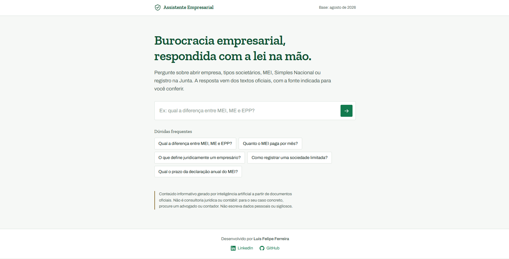

<div align="center">

# ⚖️ Simples Assim

**Assistente de IA para dúvidas de direito empresarial brasileiro.**
Responde em linguagem natural com base em legislação e documentos oficiais —
sempre indicando a fonte, o arquivo e a página.

[](https://www.python.org/)
[](https://python.langchain.com/)
[](#pré-requisitos)
[](https://fastapi.tiangolo.com/)
[](https://www.oracle.com/cloud/)

</div>

---

## O problema

Abrir e manter uma empresa no Brasil significa navegar por leis complementares,
instruções normativas e manuais de registro. A informação existe e é pública —
mas está espalhada em documentos longos, técnicos e difíceis de consultar.

Quem precisa da resposta (o empreendedor) raramente tem o vocabulário jurídico
para encontrá-la. Quem pergunta "qual a diferença entre MEI, ME e EPP?" não sabe
que a lei escreve "consideram-se microempresas ou empresas de pequeno porte...".

**Simples Assim** faz essa ponte: você pergunta em português comum, ele responde
com base no texto oficial e mostra exatamente de onde tirou cada informação.

---

## Demonstração

> _(adicionar capturas de tela aqui)_

<!--


-->

**Exemplo real:**

> **Consulta:** Quanto o MEI paga por mês?
>
> O MEI paga um valor fixo mensal, independentemente de faturar ou não naquele
> mês, por meio do DAS. O valor é a soma de: contribuição previdenciária de 5%
> do salário-mínimo; R$ 1,00 de ICMS (se for contribuinte); R$ 5,00 de ISS (se
> for contribuinte). O MEI transportador autônomo de cargas recolhe 12% em vez
> de 5%. O pagamento é devido mesmo com receita zero ou empresa inativa.
>
> **Fontes:** `[Tributário] mei_perguntas_respostas.pdf — páginas 10, 12` ·
> `[Legislação] lc123_simples_nacional.html`

**Teste de ancoragem** — o agente recusa o que está fora da base, em vez de inventar:

> **Consulta:** Qual a capital da França?
>
> Não encontrei essa informação nos documentos disponíveis.

---

## Arquitetura

```
                    ┌──────────────────────────────┐
   Navegador ──────►│  web/   HTML · CSS · JS      │
                    │  interface, sem framework    │
                    └──────────────┬───────────────┘
                                   │  POST /api/perguntar
                    ┌──────────────▼───────────────┐
                    │  api.py   FastAPI            │
                    │  valida, orquestra, serve    │
                    └──────────────┬───────────────┘
                                   │
                    ┌──────────────▼───────────────┐
                    │  src/   o agente (RAG)       │
                    └──────────────────────────────┘
```

### O pipeline de RAG

```
Documentos oficiais (PDF · HTML · TXT)
        │
        ▼
  Extração e limpeza ......... remove cabeçalhos, rodapés e texto revogado
        │
        ▼
  Chunking jurídico .......... divide respeitando "Art." e "§"
        │
        ▼
  Embeddings multilíngues .... paraphrase-multilingual-MiniLM-L12-v2
        │
        ▼
  Índice FAISS ............... busca por similaridade semântica
        │
        ├──────────────┬────────────────┐
        ▼              ▼                ▼
   Expansão de     BM25            Busca
   siglas       (palavra-chave)   semântica
        │              │                │
        └──────────────┴────────────────┘
                       │  EnsembleRetriever (40 / 60)
                       ▼
              Multi-query (opcional)
                       │
                       ▼
        Modelo de linguagem (trocável) → resposta + fontes
```

### Decisões técnicas

Cada linha aqui é uma escolha que poderia ter sido outra. Onde houve medição,
ela está.

| Escolha | Por quê |
|---|---|
| **Busca híbrida** BM25 + semântica | Texto jurídico exige as duas coisas: significado (*faturamento* ≈ *receita bruta*) e termo exato (*art. 966*, *EPP*, valores) |
| **Embeddings multilíngues** | O modelo padrão em inglês degradava a recuperação em português jurídico |
| **Chunking por artigo** | Separadores `Art.` e `§` mantêm cada dispositivo íntegro, em vez de cortar por contagem de caracteres |
| **Remoção de texto revogado** | Páginas compiladas do Planalto exibem a redação antiga *tachada*; sem tratar, o agente citaria limites que não valem mais |
| **Glossário de siglas** | Usuários escrevem "EPP"; a lei escreve "empresa de pequeno porte". A expansão é local e não custa chamada |
| **Citação via metadados** | A fonte vem da estrutura do índice, não do texto gerado — o modelo não tem como errar a página |
| **Corte do ensemble em `TOP_K`** | O `EnsembleRetriever` entrega a **união** de BM25 e semântica sem cortar: `TOP_K=10` devolvia 19 trechos, 13.519 caracteres onde se esperava 8.237. Quase o dobro do custo e da espera, sem ninguém ter decidido isso |
| **Buscador dedicado à vigência** | As notas de curadoria são 0,24% da base e perdiam todas as vagas para os documentos que elas corrigem. Acerto de fonte: 78% → 100% ([detalhes](#avaliação)) |
| **`temperature=0`** | Num agente que deve se limitar ao documento, "criatividade" é outro nome para desviar da fonte. Elevou a recusa correta de 80% para 100% e tornou a avaliação reproduzível |
| **Corte após a recusa** | Observado: o modelo recusou corretamente e, no parágrafo seguinte, inventou um tributo que não existe. A recusa estava certa; o que veio depois, não |
| **Histórico vindo do cliente** | A API fica sem estado: nada para limpar, nada que se perca no restart, funciona igual com vários processos. O preço é confiar no cliente, limitado por um teto de trocas |
| **NDJSON em vez de SSE** | O `EventSource` do navegador só faz GET, e a pergunta e o histórico precisam ir no corpo de um POST |
| **FAISS** em vez de banco gerenciado | Base de ~2.000 trechos roda local, sem servidor e sem custo |
| **Modelo local como padrão** | Quem clonar consegue testar sem chave, sem cartão e sem cota. O custo em qualidade está medido, não escondido |
| **FastAPI + front próprio** | Separação real entre cérebro e interface; o mesmo agente serve a API, a web e o terminal |

### O que foi medido e contrariou a intuição

**O gargalo não é a busca.** A busca híbrida inteira — BM25 sobre 2.099 trechos,
FAISS, embedding da pergunta — leva **0,1 segundo**. O resto da espera é o
modelo lendo o contexto.

| Etapa | Tempo |
|---|---|
| Busca completa | 0,1s |
| Modelo lendo o contexto | 15 a 60s |
| Modelo escrevendo a resposta | 3 a 13s |

Isso inverteu duas decisões. O **streaming**, construído para esconder a espera,
economiza só os segundos finais — a maior parte do tempo acontece antes da
primeira palavra. E o **tamanho do contexto**, que parecia um detalhe de
qualidade, virou o principal parâmetro de desempenho do sistema.

## Confiabilidade

Um assistente jurídico que inventa é pior do que nenhum. As defesas, em camadas:

- **Prompt ancorado** — responde apenas com o contexto recuperado e admite
  quando não sabe, com uma frase fixa e verificável.
- **Proibição de analogia** — não pode estender a uma categoria o que o
  documento afirma sobre outra. Corrige o erro clássico de assumir que ME e EPP
  seguem as mesmas regras do MEI.
- **Separação conceitual explícita** — tipo jurídico, porte e regime tributário
  são eixos independentes, e o prompt exige que não sejam confundidos.
- **Notas de vigência com autoridade estrutural** — o documento de curadoria
  registra onde o texto literal da lei está superado. Ele não concorre com os
  demais na busca: tem um buscador próprio que sempre contribui, porque sendo
  0,24% da base ele perdia todas as vagas ([por quê](#avaliação)).
- **Recusa reconhecida por padrão, não por frase** — o modelo parafraseia; exigir
  a frase exata fazia recusas legítimas passarem como resposta, e o app exibia
  fontes para um "não sei".
- **Corte após a recusa** — se o agente admite que não sabe, nada do que vier
  depois é exibido. Observado em teste: um modelo recusou corretamente e, no
  parágrafo seguinte, inventou um tributo inexistente.
- **Fontes sempre visíveis** — com o trecho exato que embasou a resposta, para
  conferência. E ocultas quando não há resposta.
- **Temperatura zero** — "criatividade" aqui é desvio da fonte.
- **Resiliência a falhas** — retentativas para sobrecarga, e mensagem honesta
  quando a cota do provedor acaba.

Nada disso é teoria: cada item acima existe por causa de um defeito que a
[avaliação](#avaliação) encontrou, e cada um tem um teste automático.

---

## Avaliação

Sem medir, *"melhorou"* é opinião. Ajustar o `TOP_K`, o peso da busca híbrida ou
o modelo vira adivinhação, porque nada diz se o resultado ficou melhor ou pior.

São **15 perguntas anotadas** — 10 que devem ser respondidas e 5 que devem ser
recusadas — rodando contra a cadeia real, sem servidor e sem chamada de API
extra:

```bash
python -m avaliacao.rodar
```

| Modelo | `TOP_K` | Acertos | Recusou certo | Fonte certa | Armadilhas | Mediana |
|---|---|---|---|---|---|---|
| `llama3.2:3b` (local) | 10 | 13/15 | 100% | 100% | 50% | 61,8s |
| `llama3.2:3b` (local) | 4 | 12/15 | 100% | 100% | 50% | 25,7s |

> Medido num i5-1135G7 sem GPU. **Um acerto a mais custa 2,4× o tempo** — é o
> trade-off entre contexto e espera, com número em vez de palpite.

### O que ela mede, e por quê

| | Pergunta que responde |
|---|---|
| **Recusa** | O sistema admite quando não sabe? É a regra mais importante do projeto |
| **Armadilha** | Evita os valores vencidos que estão no texto literal da lei? |
| **Fonte** | A busca trouxe o documento que de fato contém a resposta? |
| **Conteúdo** | Os números e termos esperados aparecem? |

A terceira é a mais útil na prática: ela **separa falha de busca de falha de
modelo**. Se a fonte certa chegou e a resposta saiu errada, mexer no `TOP_K` ou
no glossário é perda de tempo — o problema é o modelo. Se a fonte não chegou,
melhorar o prompt é inútil.

### Três defeitos que ela encontrou

Construí a avaliação esperando comparar modelos. Ela encontrou problemas no
**sistema** antes de comparar modelo nenhum.

**1. O diferencial do projeto não funcionava.** As notas de vigência são 5
trechos numa base de 2.099 — **0,24%**. Perguntado *"posso abrir uma EIRELI?"*,
o buscador ranqueia por relevância ao termo, e a distribuição é esta:

```
40 trechos  in_drei_81.pdf              tratam a EIRELI como opção válida
 7 trechos  manual_sociedade_limitada.pdf
 5 trechos  manual_empresario_individual.pdf
 2 trechos  notas_de_vigencia.txt       dizem que ela foi EXTINTA
```

Dois contra cinquenta e três. As notas perdiam **todas** as vagas, e o agente
respondia com a redação vencida — citando fonte oficial, com total confiança.

A causa é estrutural: **a informação corretiva é abafada pela informação que ela
existe para corrigir**, justamente por ser menor. A correção foi dar autoridade
estrutural ao documento de curadoria, com um buscador dedicado que sempre
contribui e entra primeiro no contexto. Acerto de fonte: **78% → 100%**.

**2. A recusa era detectada por frase exata, e o modelo parafraseia.** Estas
eram contadas como respostas válidas, e o app mostrava a lista de fontes junto
de um "não sei":

> *"Não encontrei **informações** nos documentos disponíveis sobre abertura de
> empresa em Portugal."*

**3. A medição era instável.** Com a configuração idêntica, uma pergunta passava
numa rodada e falhava na seguinte. `temperature=0` tornou as execuções
reproduzíveis — e, de quebra, elevou a recusa correta de 80% para 100%: o modelo
estava "criativamente" respondendo o que deveria recusar.

### O que ela ainda não resolve

As três falhas restantes são estáveis e conhecidas:

- **`R$ 45,65`** — o texto da LC 123 traz esse valor absoluto para a contribuição
  do MEI. É 5% do salário-mínimo **de 2016**, congelado na redação; a regra viva
  é o percentual. O modelo local cita o número; o Gemini cita o percentual.
  Nenhum dos dois erra por burrice — a armadilha está no corpus. Falta uma nota
  de vigência para esse dispositivo.
- **`desenquadramento`** e **`registro-ltda`** — a busca entrega as fontes
  certas e o modelo de 3B não as aproveita. Limitação de tamanho do modelo, não
  do sistema.

---

## Base de conhecimento

Apenas fontes oficiais (`.gov.br`). Textos de lei não são protegidos por direito
autoral (Lei 9.610/1998, art. 8º, IV).

| Categoria | Documentos |
|---|---|
| **Legislação** | Código Civil (Livro II — Do Direito de Empresa) · Lei Complementar 123/2006 |
| **Registro empresarial** | Manuais do DREI (Empresário Individual e Sociedade Limitada) · IN DREI 81/2020 |
| **Tributário** | Perguntas e Respostas MEI e Simei · Manual da DASN-SIMEI (Receita Federal) |
| **Notas de vigência** | Curadoria própria sobre dispositivos superados |

> **Escopo deliberado:** cobre as regras vigentes. Documentos da Reforma
> Tributária (IBS/CBS, em transição de 2026 a 2033) ficaram de fora para não
> misturar regimes — empresas do Simples não têm alteração em 2026.

---

## Como executar

### Pré-requisitos

| | |
|---|---|
| **Python 3.11 – 3.13** | `python --version`. No Windows, marque *"Add Python to PATH"* no instalador |
| **Git** | para clonar o repositório |
| **[Ollama](https://ollama.com/download)** | roda o modelo na sua máquina. **Sem chave, sem cadastro, sem custo** |
| **~5 GB livres** | 2 GB do modelo de linguagem + 500 MB do modelo de embeddings |
| **Internet na 1ª vez** | para baixar os dois modelos. Depois roda offline |

**Nenhuma chave de API é necessária.** O projeto vem configurado para rodar
inteiro na sua máquina. Se preferir uma API — mais rápida e com respostas
melhores — veja [Trocar o modelo de IA](#trocar-o-modelo-de-ia).

O `uvicorn` não precisa ser instalado à parte: vem no `requirements.txt`.

### Linux / macOS

```bash
git clone https://github.com/oLuisFelipeFerreira/ChatBot-Agent.git
cd ChatBot-Agent

python3 -m venv .venv
source .venv/bin/activate
pip install --upgrade pip
pip install -r requirements.txt

ollama pull llama3.2:3b            # o modelo que responde (2 GB)
cp .env.example .env               # ja vem pronto, sem chave

python testar_api.py               # confere se o modelo responde
python -m src.ingest               # constroi o indice (demora na 1a vez)

python -m uvicorn api:app --port 8000
```

### Windows (PowerShell)

```powershell
git clone https://github.com/oLuisFelipeFerreira/ChatBot-Agent.git
cd ChatBot-Agent

python -m venv .venv
.venv\Scripts\Activate.ps1
pip install --upgrade pip
pip install -r requirements.txt

ollama pull llama3.2:3b
copy .env.example .env

python testar_api.py
python -m src.ingest

python -m uvicorn api:app --port 8000
```

> Se o PowerShell bloquear o `Activate.ps1`, rode uma vez:
> `Set-ExecutionPolicy -Scope Process -ExecutionPolicy Bypass`

Depois abra **http://localhost:8000**.

**O passo que não dá para pular é o `ingest`.** Os documentos de `data/` vêm
junto com o repositório, mas `faiss_index/` está no `.gitignore` porque é
gerado — em uma máquina nova ele não existe. A API até constrói o índice sozinha
ao subir, mas aí você espera minutos olhando um terminal parado.

`python baixar_documentos.py` é **opcional**: serve para rebaixar a legislação
quando ela mudar. Ele pula arquivos que já existem.

### Outras interfaces

```bash
python -m src.main                 # terminal
streamlit run app.py               # interface Streamlit
```

### Se algo der errado

| Sintoma | Causa e solução |
|---|---|
| `'uvicorn' não é reconhecido` | O venv não está ativo, ou o script não está no PATH. Use `python -m uvicorn api:app --port 8000` |
| `ModuleNotFoundError: langchain` (ou bs4, fastapi...) | Venv não ativado antes do `pip install`. Ative e rode `pip install -r requirements.txt` de novo |
| `ANTHROPIC_API_KEY nao encontrada` | Falta o `.env` ou a chave está vazia. Ou troque o provedor no `.env` |
| `Chave de API inválida ou sem crédito` | A chave do `.env` expirou, foi digitada errada ou a conta está sem saldo. Rode `python testar_api.py` para confirmar |
| `Falta o pacote do provedor 'x'` | Instale o pacote indicado na mensagem (ex.: `pip install langchain-groq`) |
| `Indice 'faiss_index' nao encontrado` | Rode `python -m src.ingest` |
| Índice vazio / sem fontes | `data/` está vazia — confira se o clone veio completo ou rode `python baixar_documentos.py` |
| Primeira execução muito lenta | Normal: está baixando o modelo de embeddings (≈ 500 MB). Só acontece uma vez |
| Erro 529 / *overloaded* | Sobrecarga temporária do provedor. Ele já tenta de novo sozinho; para economizar chamadas, coloque `USAR_MULTIQUERY = False` em `src/agent.py` |
| Porta 8000 ocupada | `python -m uvicorn api:app --port 8001` |
| Reindexar do zero | Apague a pasta `faiss_index/` e rode `python -m src.ingest` |

---

## Trocar o modelo de IA

O projeto não depende de provedor nenhum. A geração da resposta é escolhida por
variável de ambiente, e **a busca nos documentos roda sempre local e de graça**
(embeddings HuggingFace + FAISS + BM25) — trocar de modelo não exige reindexar
nada.

| Provedor | `.env` | Pacote | Custo |
|---|---|---|---|
| **Ollama** (padrão) | `LLM_PROVIDER=ollama`<br>`LLM_MODEL=llama3.2:3b` | já instalado | **Grátis, sem chave** |
| **Google Gemini** | `LLM_PROVIDER=google_genai`<br>`LLM_MODEL=gemini-3.8-flash`<br>`GOOGLE_API_KEY=...` | já instalado | Camada gratuita |
| **Groq** | `LLM_PROVIDER=groq`<br>`LLM_MODEL=llama-3.3-70b-versatile`<br>`GROQ_API_KEY=...` | `pip install langchain-groq` | Camada gratuita |
| **Anthropic** | `LLM_PROVIDER=anthropic`<br>`LLM_MODEL=claude-haiku-4-5-20251001`<br>`ANTHROPIC_API_KEY=...` | já instalado | Pago |
| **OpenAI** | `LLM_PROVIDER=openai`<br>`LLM_MODEL=gpt-4o-mini`<br>`OPENAI_API_KEY=...` | `pip install langchain-openai` | Pago |

```bash
python testar_api.py    # confirma qual provedor está ativo e se ele responde
```

### Sobre a troca de modelo, honestamente

O prompt é rígido de propósito: não inventar, não generalizar por analogia,
citar o artigo, devolver uma frase exata quando não souber. **Modelos menores
obedecem essas regras com menos consistência** — e o quanto está medido na
seção [Avaliação](#avaliação), não escondido.

O resultado contraria o senso comum em um ponto: o modelo local de 3B **recusou
100% das perguntas fora de escopo**, incluindo as difíceis (abrir empresa em
Portugal, alíquota de IPVA, férias CLT). Ele não inventa — ele às vezes se
omite. Para um assistente jurídico, **errar por omissão é a falha barata**, e
isso é mérito da ancoragem, não do modelo.

### Duas armadilhas que vão te pegar

**Versão do pacote do provedor.** As versões mais novas de
`langchain-google-genai` e `langchain-ollama` exigem `langchain-core` 1.x e
quebram o `langchain` 0.3 deste projeto. O sintoma aparece só na importação:
`ModuleNotFoundError: No module named 'langchain_core.memory'`. As faixas
compatíveis estão fixadas no `requirements.txt`. Rode `pip check` depois de
instalar qualquer coisa nova.

**Janela de contexto do Ollama.** O padrão dele é pequeno e ele **corta o prompt
em silêncio** quando o contexto não cabe — sem erro e sem aviso. O sintoma é "o
modelo é burro"; a causa é que ele nunca recebeu o texto inteiro. O projeto
define `OLLAMA_NUM_CTX=8192` por isso.

---

## Deploy

Roda em uma instância **OCI Compute** (Ampere A1, Ubuntu 24.04), dentro de uma
VCN com sub-rede pública e Internet Gateway.

```bash
# na instância
git pull && source .venv/bin/activate
pip install -r requirements.txt

nohup uvicorn api:app --host 0.0.0.0 --port 8000 > servidor.log 2>&1 &
```

Portas liberadas na Security List da OCI **e** no firewall interno (`iptables`),
com a regra inserida antes do `REJECT` da cadeia INPUT.

---

## Estrutura

```
.
├── api.py                      # API FastAPI + serve o front
├── app.py                      # interface Streamlit (alternativa)
├── baixar_documentos.py        # rebaixa a base oficial quando a lei mudar
├── testar_api.py               # checa se o provedor de IA responde
├── web/                        # front-end, sem framework
│   ├── index.html
│   ├── estilo.css
│   └── app.js
├── src/
│   ├── ingest.py               # extração, limpeza, chunking e indexação
│   ├── busca.py                # busca híbrida, glossário, vigência
│   ├── agent.py                # prompt ancorado, provedor e cadeia
│   ├── limite.py               # limite por IP e cota diária
│   ├── registro.py             # registro das consultas (JSONL)
│   ├── main.py                 # interface de terminal
│   ├── inspecionar_indice.py   # diagnóstico de recuperação
│   └── ver_chunks.py           # busca literal no índice
├── avaliacao/
│   ├── perguntas.json          # 15 perguntas anotadas
│   ├── rodar.py                # executa e produz a tabela
│   └── resultados/             # um JSON por configuração testada
├── data/                       # documentos, organizados por categoria
├── test_ancoragem.py           # recusa, paráfrase e corte de alucinação
├── test_vigencia.py            # as notas de curadoria chegam ao modelo?
├── test_memoria.py             # histórico de conversa
├── test_limite.py              # limite de requisições
├── test_provedor.py            # troca de provedor
├── requirements.txt
└── .env.example
```

Os testes não usam framework nem rede: rodam com `python test_*.py` e levam
menos de um segundo. Cada um existe por causa de um defeito que aconteceu de
verdade — o docstring de cada arquivo conta qual.

---

## Tecnologias

`Python` · `LangChain` · `Claude · Gemini · Groq · Ollama (trocável)` · `FAISS` · `sentence-transformers`
· `rank_bm25` · `BeautifulSoup` · `pypdf` · `FastAPI` · `Uvicorn` · `Streamlit`
· `Oracle Cloud Infrastructure`

---

## Próximos passos

Em aberto, por ordem de valor:

- [ ] **Nota de vigência para o `R$ 45,65`** do art. 18-A — a armadilha que a
      avaliação encontrou e ainda não foi corrigida
- [ ] Ampliar a avaliação para ~40 perguntas e rodar contra mais de um modelo,
      publicando a comparação
- [ ] Fontes clicáveis, abrindo o PDF na página citada
- [ ] Registro de perguntas sem resposta alimentando a avaliação
- [ ] HTTPS com domínio próprio e serviço `systemd`
- [ ] Ampliação para direito trabalhista e contratos empresariais

Feito e medido: busca híbrida, camada de vigência com autoridade estrutural,
memória de conversa, streaming, limite por IP, modelo trocável, avaliação
reproduzível.

---

## Autor

**Luís Felipe Ferreira**

[LinkedIn](https://www.linkedin.com/in/luís-felipe-barbosa-ferreira-33a0a9210) ·
[GitHub](https://github.com/oLuisFelipeFerreira)

Projeto desenvolvido a partir do desafio final do curso de Agentes de IA da
**Alura**, expandido para uso real.

---

> ⚠️ **Conteúdo informativo gerado por IA a partir de documentos oficiais.**
> Não constitui consultoria jurídica ou contábil. Para casos concretos,
> procure um advogado ou contador.
