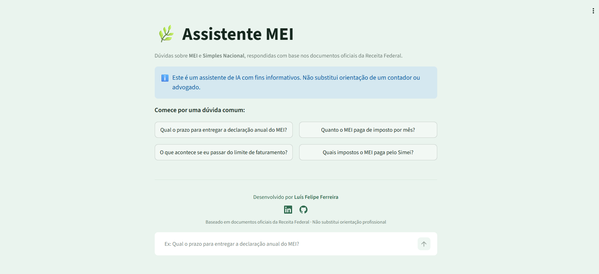

# 🌿 Assistente MEI

Agente de IA que responde dúvidas sobre **MEI** e **Simples Nacional** em linguagem
natural, com base em documentos oficiais da Receita Federal — e sempre citando a
fonte (arquivo e página) de cada resposta.

Projeto final do curso de Agentes de IA da **Alura**, com deploy em produção na
**Oracle Cloud Infrastructure (OCI)**.

🔗 **Aplicação no ar:** http://167.234.228.36:8501


---

## 📌 O problema

Empresários e microempreendedores têm dúvidas recorrentes e caras sobre obrigações
fiscais: *quando declarar*, *quanto pagar*, *o que acontece se passar do limite*.
As respostas existem em manuais oficiais da Receita Federal — documentos longos,
técnicos e difíceis de navegar.

Este agente permite perguntar em português comum e receber a resposta direta,
com a indicação exata de onde ela foi encontrada no documento oficial.

---

## 🧠 Como funciona (arquitetura RAG)

O projeto usa **RAG** (*Retrieval-Augmented Generation*), técnica em que o modelo
de linguagem primeiro **busca** trechos relevantes nos documentos e só então
**gera** a resposta — evitando que invente informação.

```
Documentos PDF (Receita Federal)
        │
        ▼
   Limpeza de texto ......... remove cabeçalhos, rodapés e sumários
        │
        ▼
   Chunking (800 chars) ..... divide em trechos com sobreposição de 100
        │
        ▼
   Embeddings (local) ....... HuggingFace all-MiniLM-L6-v2 (384 dimensões)
        │
        ▼
   Vector store ............. FAISS (busca por similaridade semântica)
        │
        ▼
   Retriever (top-4) ........ recupera os trechos mais relevantes
        │
        ▼
   LLM (Claude Sonnet) ...... gera a resposta ancorada nos trechos
        │
        ▼
   Resposta + fontes ........ arquivo e página de cada trecho usado
```

### Decisões técnicas e o porquê

| Escolha | Motivo |
|---|---|
| **FAISS** (em vez de Pinecone/Chroma) | Roda local, sem servidor nem custo; ideal para uma base pequena |
| **Embeddings HuggingFace locais** | A Anthropic não oferece modelo de embeddings; o modelo local é gratuito e não exige outra API key |
| **Prompt de ancoragem** | Instrui o modelo a responder **somente** com o contexto recuperado, e a admitir quando não sabe |
| **Fontes extraídas dos metadados** | A citação vem da estrutura do índice, não da geração — o modelo não pode errar a página |
| **Streamlit** (em vez de FastAPI + React) | Interface web em Python puro, adequada ao escopo e ao prazo do projeto |

---

## 🛡️ Controle de alucinação

O agente é instruído a usar **apenas** o contexto recuperado. Quando a pergunta
está fora do escopo dos documentos, ele responde explicitamente que não encontrou
a informação, em vez de arriscar uma resposta incorreta.

---

## 💬 Exemplos de perguntas e respostas

### Pergunta dentro do escopo

> **Qual o prazo para entregar a declaração anual do MEI?**
>
> O prazo para entrega da DASN-SIMEI, situação NORMAL, é até o último dia do mês
> de maio do ano-calendário seguinte. A declaração estará disponível para
> preenchimento a partir de janeiro do ano seguinte.
>
> No caso de EXTINÇÃO do CNPJ, o MEI deverá entregar a DASN-SIMEI de "Situação
> ESPECIAL" até:
> - O último dia do mês de junho, quando a extinção ocorrer no primeiro quadrimestre;
> - O último dia do mês subsequente à extinção, nos demais casos.
>
> 📚 **Fontes:** mei_manual_dasn.pdf (pág. 14), mei_manual_dasn.pdf (pág. 4),
> mei_perguntas_respostas.pdf (pág. 14)

### Pergunta fora do escopo (teste de ancoragem)

> **Qual a capital da França?**
>
> Não encontrei essa informação nos documentos disponíveis.

O modelo sabe a resposta, mas está corretamente restrito aos documentos indexados.

---

## 📚 Base de conhecimento

Documentos oficiais da Receita Federal / Comitê Gestor do Simples Nacional:

1. **Perguntas e Respostas MEI e Simei** — material oficial em formato de dúvidas frequentes
2. **Manual da DASN-SIMEI** — declaração anual do microempreendedor individual

> **Escopo definido de propósito:** o agente cobre as regras **atuais** de MEI e
> Simples Nacional. Documentos da Reforma Tributária (IBS/CBS, em transição de
> 2026 a 2033) foram deixados de fora para não misturar regimes e gerar respostas
> ambíguas — empresas do Simples não têm alteração em 2026.

---

## 🛠️ Tecnologias

- **Python 3**
- **LangChain** — orquestração da cadeia de RAG
- **Claude (Anthropic)** — modelo de linguagem
- **HuggingFace / sentence-transformers** — embeddings locais
- **FAISS** — vector store
- **pypdf** — leitura dos documentos
- **Streamlit** — interface web
- **Oracle Cloud Infrastructure (OCI Compute)** — deploy

---

## 🚀 Como executar localmente

```bash
# 1. Clone o repositório
git clone https://github.com/oLuisFelipeFerreira/alura-agent.git
cd alura-agent

# 2. Crie e ative o ambiente virtual
python -m venv .venv
source .venv/bin/activate      # Windows: .venv\Scripts\activate

# 3. Instale as dependências
pip install -r requirements.txt

# 4. Configure a chave de API
cp .env.example .env
# edite o .env e preencha ANTHROPIC_API_KEY

# 5. Rode a interface web
streamlit run app.py
```

Para usar via terminal (sem interface):
```bash
python -m src.main
```

O índice vetorial é construído automaticamente na primeira execução, a partir dos
documentos da pasta `data/`.

---

## ☁️ Deploy na OCI

A aplicação roda em uma instância **OCI Compute** (Ampere A1, Ubuntu 24.04),
dentro de uma VCN com sub-rede pública e Internet Gateway.

Etapas realizadas:
1. Provisionamento da instância Compute no tier Always Free
2. Configuração da VCN, sub-rede pública e IP público
3. Liberação das portas 22 (SSH) e 8501 (aplicação) na Security List e no firewall interno
4. Clone do repositório, ambiente virtual e instalação de dependências na instância
5. Execução do Streamlit exposto em `0.0.0.0:8501`

```bash
streamlit run app.py --server.address 0.0.0.0 --server.port 8501
```

---

## 📂 Estrutura do projeto

```
alura-agent/
├── app.py                    # interface web (Streamlit)
├── .streamlit/
│   └── config.toml           # tema visual
├── src/
│   ├── ingest.py             # leitura, limpeza, chunking e indexação
│   ├── agent.py              # chain de RAG + prompt de ancoragem
│   ├── main.py               # interface de linha de comando
│   └── inspecionar_indice.py # utilitário para testar a busca semântica
├── data/                     # documentos de referência (PDFs)
├── requirements.txt
└── .env.example
```

---

## 🔮 Evoluções possíveis

Em um cenário de produção, os próximos passos naturais seriam:

- **Pipeline de atualização**: reprocessar automaticamente os documentos quando a
  Receita publicar novas versões, mantendo o índice sincronizado
- **Monitoramento de qualidade**: registrar perguntas sem resposta para identificar
  lacunas na base de conhecimento
- **Feedback do usuário**: botão de avaliação por resposta, alimentando o ciclo de melhoria
- **HTTPS e domínio próprio**: certificado TLS e nome de domínio no lugar do IP
- **Serviço persistente**: systemd para manter a aplicação no ar após reinicializações

---

## 👤 Autor

**Luís Felipe Ferreira**

[LinkedIn](https://www.linkedin.com/in/luís-felipe-barbosa-ferreira-33a0a9210) ·
[GitHub](https://github.com/oLuisFelipeFerreira)

---

> ⚠️ Este é um assistente de IA com fins informativos e educacionais.
> Não substitui a orientação de um contador ou advogado.
